# Version 2 class contracts

Updated 16 October 2026. This document specifies the extracted classes, their
integration boundaries, and what remains outside them. Read it with the
[speech lifecycle contract](speech-recognition-v2.md) and
[FSM scenarios](fsm-v2-cases.json). A passing supplied-transcript test is not
evidence of physical microphone accuracy.

## Responsibility map

| Component | Owns | Must delegate |
| --- | --- | --- |
| `SpeechCommandBranchPolicy` | Preference between eligible interpretation plans | Eligibility, parsing, FSM destinations, execution |
| `SpeechContinuationSession` | Open collection, consumed spans, expected-surface membership, lifecycle and silence deadline | Recognition, language rules, permissions, transaction settlement, playback |
| `OwnedFeedbackScope` | Deferred feedback and cancellation leases for one workflow | When that workflow is valid, audio synthesis, playback ordering across owners |
| SpeechMenu | Orchestration of recognition, planning, lifecycle and serialized dispatch | Lifecycle to the session; plan ordering to policy; feedback ownership to scope |
| Existing ApplicationCoordinator / CommandOperation | Effect ownership, locks, pending acknowledgements, checkpoint/rollback | Language parsing and recognition |
| Existing language parsers / value contexts | Language-specific values and valid/incomplete/malformed/defer decisions | UI rendering and action execution |

The three new classes are classic scripts that register their class on
`globalThis`. Load `OwnedFeedbackScope.js` and `SpeechCommandBranchPolicy.js`,
then `SpeechContinuationSession.js`, before SpeechMenu. The application runtime
loader and speech asset cache include them. Tests install the same sources through
`tests/speech-lifecycle-fixture.mjs` in the correct Node or browser scope.

## SpeechContinuationSession

Construct with `{id, surfaces, now, schedule, unschedule, onError, feedback}`.
Only `id` identifies the session; the other arguments have defaults. `surfaces`
contains opaque destination tokens. The three clock functions are injectable so
deadline behavior can be tested without a microphone, DOM, or wall-clock sleep.
`feedback` can inject an OwnedFeedbackScope-compatible object; otherwise the
session constructs one. `onError` receives feedback adapter errors.

| API | Contract |
| --- | --- |
| `phase` | `collecting`, `settling`, `accepted`, or terminal `cancelled` |
| `collectors` | Map of collector identity to its current parsing state |
| `acceptedSpans` | Consumed command spans; consumption is distinct from persisted effects |
| `expectedSurfaces` | Set of destinations already authorized/projected by the caller |
| `context` | Current opaque continuation context |
| `observe(text)` | Update the hypothesis and return to collecting; interrupt owned active feedback on changed text, while retaining pending feedback for arbitration |
| `transfer(context, surface)` | Preserve collector and deadline across an expected destination; return false for an unexpected surface or cancelled session |
| `armSilence(delay, expire)` | Schedule one nonnegative finite delay, replacing the previous timer; expose the absolute `deadline` |
| `cancelSilence()` | Cancel the deadline and fence callbacks from the old timer |
| `deferFeedback(key, start)` | Queue replaceable owned feedback; return its identity-specific cancellation function |
| `cancelFeedback(reason, discard)` | Interrupt playback, optionally preserving pending feedback |
| `settle(true)` | Accept after external final-decode/transaction checks, cancel the timer, and release pending feedback once |
| `settle(false)` / `cancel(reason)` | Close the session, cancel timers and feedback, clear collectors, reject late input/transfer |

```mermaid
stateDiagram-v2
    [*] --> collecting
    collecting --> collecting: expected UI transition / growing text
    collecting --> settling: silence expires; request final decode
    settling --> collecting: collection explicitly resumes
    settling --> accepted: final decode and root effects accepted
    collecting --> cancelled: cancellation / failed root
    settling --> cancelled: invalid final / failure
    accepted --> collecting: next input in the same capture
    cancelled --> [*]
```



Silence expiry only calls the injected `expire` function. It cannot accept the
last partial or authorize an action. The orchestrator must request the recognizer
final, run root validation, and settle the operation before `settle(true)`.
Recognition final timeout/failure belongs to the recognizer/coordinator layer.
Actual resumed-speech events cancel the deadline through the orchestrator; receiving
a hypothesis alone must not manufacture a new adaptive pause window.

The FSM must validate context, destination, and permissions before transfer.
Surface membership is a continuity guard, not authorization. An unexpected transfer
returns false without changing the collector/context/deadline; its caller decides
how to cancel or roll back the operation.

The current SpeechMenu adapter lazily creates a session and shares its existing
collector, surface and consumed-span containers with it. During migration these
are aliases, not two copies. An invalidated root gets a fresh session before an
independent root can reuse the same acoustic capture. A cancelled session itself
is never revived. A replacement implementation should give logical sessions their
own identity and retain the acoustic/decoder IDs separately. The class does not
merge independently ended utterances or choose continuity rules for them.

## OwnedFeedbackScope

This class is reusable outside speech: a pointer-triggered workflow can own the
same kind of deferred prompt or chime as a voice-triggered workflow.

Construct with `{onError}`. Use stable keys for feedback that should replace an
older version, and separate keys for independent messages.

| API | Contract |
| --- | --- |
| `defer(key, start)` | Replace that key's pending/active feedback; return cancellation for this exact entry |
| `release()` | Start pending entries once at the caller-selected acceptance boundary |
| `interrupt(reason, {discardPending})` | Abort/stop active leases, optionally discard pending entries; scope remains reusable |
| `cancel(reason)` | Permanently close the scope and cancel all owned entries |
| `closed`, `pendingCount`, `playingCount` | Lifecycle/diagnostic state without exposing internal queue maps |

The start callback receives an AbortSignal. It can return a stop function or a
handle with `stop()` and optional `finished` promise. An ongoing asynchronous
adapter must return a handle; a callback without one is considered fire-and-forget
and leaves no active lease. Each scope affects only the handles it owns.

```js
const feedback = new OwnedFeedbackScope({onError: reportPlaybackFailure});
const cancelPrompt = feedback.defer('next-step', signal =>
    playbackAdapter.start('Say standard time', {signal}));

// Called only after final interpretation and workflow acceptance:
feedback.release();

// Resumed input, a replaced state, or cancellation:
feedback.interrupt('continuation-resumed');
```

`playbackAdapter.start` in this example is an adapter contract, not a new existing
AudioEngine method. It must return `{stop, finished}` for active cancellation.
Native/global synthesis cancellation must not be substituted for an owned stop
if it would cancel unrelated feedback.

Identity rules are essential: an old cancellation function cannot cancel its
replacement; an old finished promise cannot remove a newer lease; cancellation
inside `start` also stops a handle returned afterward. Cancellation of another
pending entry during release prevents that entry from starting. Playback callback
errors are reported without preventing unrelated queued entries from starting.

The scope is not a global announcement scheduler. It does not assign priorities
between workflows, synthesize text, or alter an operation's business outcome.
The existing semantic announcement scheduler and direct dialog speech calls still
need migration to adapters that honor the lease contract. Do not claim that all
active native speech can already be stopped by this extraction.

## SpeechCommandBranchPolicy

`compare(left, right, {final})` returns a positive value if `left` is preferred,
negative if `right` is preferred, and zero on a tie. Missing plans are lower
priority. Ties retain the planner's existing order. Inputs are eligible plans with
`steps`, `pending`, `invalid`, `exact`, and `consumedWords`.

Pending metadata distinguishes a viable literal prefix (`hasCommandPrefix`) from
a command head with its first word actually recognized (`headStarted`). A whole
unresolved head such as `ready a...` takes precedence over a decomposition that
would execute Ready and open the wrong state. A fragment such as `o` must not
automatically outrank an already introduced `sync o...` continuation. Final input
removes the interim hold and lets root validation settle complete/invalid plans.

**Compatibility note:** the partial-token guard is implemented because the planned
grammar-switching solution is not yet in place. Experimental routing exists, but
the deferred custom native implementation has not been built. Review the guard
after switching is implemented; preserve root validity, consumed-span and ownership
invariants regardless. The user explicitly requested implementing the fix now,
with this note, rather than deferring the bug.

An invalid final continuation must consider both newly planned steps and the
root's already consumed but uncommitted steps. A shorter terminal match must not
settle that root and escape rollback simply because its opener left the live text.
This remains a root/executor responsibility, not a side effect of policy comparison.

## Evidence and remaining work

- `tests/owned-feedback-scope.mjs`: deferred/replaced feedback, stale cancellation
  and completion, cancellation during startup, errors, and owner isolation.
- `tests/speech-continuation-session.mjs`: retained collectors/deadlines through
  handoff, stale timer fencing, delayed final settlement, cancellation, branch policy.
- `tests/speech-command-digest.mjs`: partial `sync o` cannot toggle Sync or run Off;
  growing values and consumed-command ordering remain intact.
- `tests/app-state-transactions.mjs --speech-boundaries`: invalid final continuation
  rolls back its uncommitted Ready root, without undoing earlier independent roots.
- Existing handoff, delayed-final, Vosk context, and adaptive continuation tests
  exercise the adapters. Native microphone recognition is separate verification.

The active-trip Ready failure and live Speech Off recognition failure remain open
tasks. `--branch-boundaries --voice-feedback` is a local investigation fixture,
not a passing release gate while its active-trip Ready assertion remains unresolved.
Keep Version 2's required behavior separate from evidence of completed integration.

## Other extraction candidates (planned, not implemented here)

| Class | Responsibility | Existing component to retain |
| --- | --- | --- |
| AnnouncementScheduler | Global feedback ordering/priority and adapter execution | Announcement definitions, AudioEngine |
| ValueEntrySession | Typed draft, validation, confirm/cancel, return destination | Language parsers; keypad/voice-pad views |
| SurfaceNavigator | Dialog stack and expected/return transitions | FSM and ApplicationCoordinator |
| TripWorkflow | Draft, immediate/scheduled start, deferral, summary | ClockTimer and persistence |
| BreakWorkflow | Type, interval identity, confirmation/cancellation | ClockTimer interval model |
| LoginSession | ID/PIN/review/submission/retry, focus instructions | IdentityContext and server authentication |
| TripLogController | Range requests, stale-response cancellation, pinned/loading state | TripLog rendering and aggregates |

Extract a cohesive responsibility behind its current public behavior, add boundary
tests, then migrate callers. Avoid a class per function or a second application-wide
state machine that competes with the coordinator. `app.js` should progressively
become component construction and wiring.


## SpeechRejectionFeedback

This class adapts confirmed `speechAttemptRejected` events to a playback callback.
Construct with `{events, play, enabled, onError, rememberedRoots}`; call `dispose()`
to remove its listener. It remembers up to 256 logical roots by default and fences
repeated partial/final reports. Muted reports are consumed without replay on unmute.
The application adapter uses `playSemanticSong("speech-rejected")`, preserving the
existing audio settings. The song has no spoken announcement: a short downward
D-sharp-to-A bend with a quiet low supporting note, using the existing instrument.

The event contract is `{id, rootId, source:"recognition", confirmed:true, outcome,
reason, transcript}`. SpeechMenu owns semantic classification and root identity;
the playback class does not infer rejection from silence or backend errors.

| Outcome | Playback boundary |
| --- | --- |
| malformed | Once the owned section is definitively rejected |
| incomplete | Adaptive silence ends collection and final decoding confirms incompleteness |
| invalid-value | Final decoding rejects the collected value |
| unrecognized | Final decoding cannot resolve a command attempt |

Viable continuation, ignored noise/junk, success, cancellation, muting, hardware
errors and server/business failures are silent. Each rejected root can cue once;
earlier independent successful roots retain their effects. A final incomplete
longer command head retains ownership over a shorter pending split, while a fully
valid command can settle at silence. Thus incomplete `ready at` must not execute
bare `ready` and discard `at`.

Evidence: `tests/speech-rejection-feedback.mjs` verifies selection, deduplication,
mute/disposal and the approved song. `tests/app-state-transactions.mjs
--rejection-feedback --voice-feedback` exercises actual malformed input, silence
plus decoder final, invalid values, unknown commands and silent exclusions.
These are local automated checks; live microphone validation and deployment are separate.

## Tone-referenced Time readback

Implemented locally through `SpeechDurationEstimator` and `ToneReferencedAnnouncement`.
See [the complete Version 2 Time implementation contract](time-reference-v2.md) for
wording, projection math, speed/voice measurements, timing, retries, ownership,
settings, display limitations and executable verification. Neither this change
nor the rejection-cue class has been deployed yet.

Speech feedback adapters bind after `speech-runtime-ready` (or immediately when the runtime already exists). App startup must not read `SpeechMenu.events` before lazy loading finishes. Binding is idempotent so the same app cannot duplicate rejection listeners. The settings browser integration test covers cold app startup with this lazy runtime.


## ValidatedCommandBuffer — accepted work independent of capture

`ValidatedCommandBuffer.js` owns ordered validated components and their display
lifetime. SpeechMenu remains responsible for grammar validation, projected
continuations, authorization, execution contexts, transactions and effects. Native
capture end/restart is not a buffer cancellation event.

- `enqueue({id, ownerId, chainId, transcript, commandId, ttl, ...metadata}, execute)`
  accepts one validated component and returns its completion promise. Component
  IDs are monotonically unique within the logical utterance; they must not reset
  when a root commits or capture restarts. Reusing an ID returns the original
  promise. The existing command-ID plus execution-context guard still decides
  whether a planned command can dispatch. A guard skip uses `SKIPPED`, preserving
  successful chain semantics while removing the duplicate presentation entry.
- `snapshot`, `pending`, `pendingOwner`, and `hasPendingOwner(ownerId)` expose the
  accepted work needed for presentation and capture handoff. Snapshot records
  include acceptance/completion timestamps and resolved execution context.
- `annotate(id, metadata)` records the command ID/context resolved immediately
  before dispatch, after preceding actions have changed state.
- `cancelChain(chainId)` discards an invalid logical root without removing earlier
  independent roots from the same acoustic utterance. `cancelOwner(ownerId)` and
  `cancelAll()` support wider explicit cancellation. Queued canceled work never
  executes. Active cancellation relies on existing transaction/authorization
  checks to prevent stale commits; a completed callback cannot turn cancellation
  into reported success.

`onChange` publishes entries, pending status and ordered text. The Mic Bar consumes
`speechCommandBufferChanged`; it appends newly accepted components while earlier
work is pending, including across native recognizer restarts. Raw hypotheses and
rejected alternatives never enter this buffer. Interim revisions remain in the
existing selected-transcript path; they do not append copies of the same command.

Hold completed components while any buffered work remains pending. Start the
normal idle transcript TTL only after that work drains; honor command/host
`speech-transcript-timeout`, with `speech-response-timeout` as fallback. Native
transport status must not overwrite retained accepted text. Timer host functions
are invoked through bound wrappers to avoid browser illegal-invocation errors.
The default bound is 128 entries; overflow is explicit rather than silently
dropping accepted commands.

A new capture utterance inherits the pending predecessor's projected frames and
continuation context. Execution stays ordered and rechecks cancellation and hard
gates. If the predecessor fails, dependent projected work cannot execute. Pure
selection does not wait for an already validated terminal command's UI action;
unvalidated tails whose destination is unknown may retry after the existing
transition boundary. Authentication failure must still block its suffix.

Tests: `validated-command-buffer.mjs`, `web-speech-browser.cjs` (blocked command,
restart, append, ordered execution), `web-speech-login-browser.cjs`,
`web-speech-command-selection.mjs`, and `speech-command-digest.mjs`. These are
simulated browser-result checks, not Android acoustic accuracy measurements.

## SpeechValueCollector: shared value lifecycle

`SpeechValueCollector.js` owns one logical value independently of the recognizer,
DOM, language, and application effect. Duration, clock, and percentage commands
already use it. Atomic digit input keeps its declared length/confirmation rules;
it does not inherit duration-style waiting. Future date or option collectors can
use the same class with their own classifier and completion policy.

The classifier contract is `classify(text, {final, ...options})`, returning
`{status, value?, ...metadata}`. Status is `incomplete`, `valid`, `defer`, or
`malformed`. `valid` means parseable, not necessarily finished. Keep linguistic
interpretation in the existing language value parsers/preprocessor. Neither pads
nor recognizers should invent an alternative duration/time parser.

| API | Contract |
| --- | --- |
| `update([{id, text, final}])` | Replace mutable source slots; retain prior finalized slots; ignore replay of the same final identity. Missing mutable slots are removed. |
| `sealCapture()` | Freeze the last selected source spans when their capture ends, preserving `final` separately; logical validation still waits for a boundary. |
| `project(segments)` | Build an alternative transcript without mutating the live collection. |
| `evaluate({boundary, canContinue, ...options})` | Classify the entire accumulated value and report `settled`; no action is invoked. |
| `complete(options)` | Mark a logical boundary once, cancel its value deadline, and return the final classification; subsequent calls return `undefined`. |
| `cancel()` | Clear text, cancel the owned deadline, reject later updates, and prevent completion. |
| `transcript`, `segments`, `status`, `completed` | Observe current collection without acquiring execution ownership. |

Identity is source identity, not text equality: browser slots are named
`captureSessionId:resultIndex`. Interim revisions replace that slot. Finalized
slots are immutable and may be replayed harmlessly. A closed capture may seal its last selected interim without claiming it was a
native final. Revalidate the accumulated text at the logical boundary. Two distinct slots containing
`one` must remain `one one`; never deduplicate words or guess overlap from suffixes.
The default bound is 64 segments. Overflow fails explicitly.

`SpeechContinuationSession.valueCollector(key, options)` creates or returns an
owned collector. It survives expected context/surface transfer. Each value owns a
child continuation deadline using the same clock/scheduler infrastructure; a
speculative command replan may cancel the command deadline without cancelling the
value deadline. Cancelling the parent cancels its collectors and their child
deadlines, including stale timer callbacks. Do not share a single cancellable timer
between value collection, command planning, and capture recovery.

### Browser integration and completion

`WebSpeechRecognizer` supplies candidates with source-slot identities to the pure
SpeechMenu selector. The selector reports `collectingValue` when the remaining
value is valid but extensible, or a registered classifier recognizes an incomplete
value. Invalid alternatives are not promoted. Selection and speculative grammar
probes never commit UI effects or mutate the live collector.

For an open value, native `isFinal` confirms a source segment only. The adapter
emits a selected transcript with logical `isFinal: false` and `segmentFinal: true`.
It advances the native slot offset, retains the logical utterance/collector, and
starts an owned silence deadline. New source slots append; a new capture session
changes the source ID namespace, not the logical value owner. Native `end` restarts
capture without rejecting or submitting the open value.

A valid next command or confirmation supplies an explicit boundary. Otherwise the
silence delay comes from the existing adaptive continuation pause plus dispatch
delay. Silence delivers one logical final transcript through normal SpeechMenu
validation and transaction handling. The shared parser validates the whole value
again at that boundary; an incomplete/malformed remainder cannot earn the valid
prefix's effects. Explicit stop/off/cancellation discards the open collection.
Missing recognition results remain subject to the separate capture watchdog.

Only a settled command component enters `ValidatedCommandBuffer`. The pads render
that accepted value; they do not accumulate recognition fragments themselves.
Every dispatch, whether first observed as interim or final, reserves command ID
plus execution context before invocation. A native final, a timer, and a restart
must never independently invoke the same accepted component.

### Required Version 2 regression cases

- `an hour` -> `an hour and` -> `an hour and five`, as revisions of one slot.
- Final `an hour`, then final `and five`, including a native restart between them:
  exactly one `1:05:00` value; no interim `1:00:00` commitment or `0:05:00` replacement.
- Final `ready at five`, then final `thirty`: exactly one scheduled `5:30` action.
- Native end without a final slot: retain the selected interim across restart,
  then revalidate once at the logical silence/command boundary.
- Replayed final slots: neither appended text nor extended/cancelled silence.
- Identical text in distinct slots: retain legitimate repeated words/digits.
- Incomplete/malformed final value: reject the value, without applying its prefix.
- Context handoff: preserve collector, source identities, and deadline.
- Parent cancellation/off: clear collection and fence late results/timers.
- Explicit following command/confirmation: release through normal ordered dispatch.

Tests are `speech-value-collector.mjs`, `web-speech-recovery.mjs`,
`web-speech-value-collection-browser.cjs`, `web-speech-command-selection.mjs`,
`web-speech-login-browser.cjs`, and `speech-command-digest.mjs`. Browser result
fixtures simulate segment timing; physical Android acoustic verification remains
separate. Load `SpeechValueCollector` before SpeechMenu/browser recognition starts.
