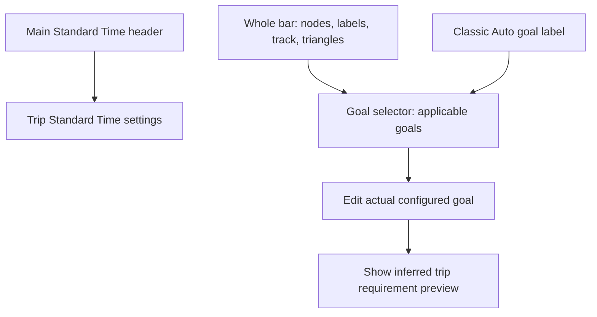

# Percentage display

Settings → Percentage display offers Classic and Goal bar beneath Clock/Timer
Settings. Classic remains the default. The saved account setting is
`wmof.clock.percentageDisplay` (`classic` or `bar`). Publisher snapshots carry
`viewData.percentageDisplay`; Drop-In uses the same renderer and model.

## Idle and active states

With no production trip, the scale starts at 0% and ends at the highest configured
goal, capped at 150% (including Standard at 100%). Nodes use the configured Trip
and overarching aggregate percentages, not inferred requirements. There is no
Current node and no time labels. Standalone breaks use this same no-standard
presentation. `goal_bar.active` distinguishes it from the active projection.

Starting a production trip replaces aggregate values with inferred trip
requirements. Ending it restores the configured values and clears stale failed
states and times. Drop-In follows the same snapshots. Loading an existing trip
must select the active projection after restoration, not treat it as a new start.

## Model and time meaning

`ClockTimer.getGoalBarSnapshot()` always supplies Standard (100%) and, during an
active trip, Current's counted trip percentage. Trip mode adds only the manual Trip
goal. Day/Week/Money/Month/Year/Custom modes add only the selected aggregate's
inferred trip requirement, with no Trip goal node. Auto includes both Trip and the
selected aggregate. The same visibility rules apply to idle configured goals.
Hidden goals do not participate in failure markers, retained failed nodes or the
failed-goal selector. All active node percentages and times describe the current
trip, never aggregate elapsed history or raw aggregate percentages. The configured aggregate goal and its inferred trip requirement are
different: a Day goal of 110% can require 125% on this trip. Editors retain the
configured overarching value. Calculated requirements may exceed 150%; do not
clamp those calculations to the input limit.

Only the next target (highest unfailed visible goal) and Current show detailed
values. Other unfailed nodes retain their circles and names, with no time caption,
time or percentage. Idle shows the highest configured visible goal percentage
without times or Current. When all goals have failed, retain Standard at the right
with its time and 100% reference values alongside Current.

Time strings sit above detailed nodes; exact percentages sit below them. Both use the
approved 16px preferred font, shrinking together only when space requires it.
Mode captions use 10px and goal names 11px. Each goal's
counted position is `tripStandard / (inferredTripPercent / 100)`.

**Remaining mode uses Standard as zero**, independently of the active goal:
`nodeRemaining = tripStandard - nodeCountedPosition`. Current uses
`tripStandard - tripCountedElapsed`. Standard is therefore always 0:00 remaining;
Current reaches 0:00 when its percentage reaches 100%. The main time readout uses this same calculation and exactly matches Current
in the selected time mode.

For a 30-minute standard, 100%, 110% and 125% correspond to counted positions
30:00, 27:16 and 24:00. Their bar Remaining values are 0:00, approximately 2:43 and
6:00. Current at 150% means 20 counted minutes and 10:00 remaining against Standard.
The existing formatter supplies the exact displayed rounding and sign. Below
100%, Current has negative Standard remaining.

Elapsed mode shows counted trip positions, without aggregate elapsed history.
Standard's 100% node shows the trip standard duration (30:00 in this example);
Current shows counted trip elapsed and coincides with Standard at 100%.
End Time uses each node's trip counted position and the existing trip deadline
formatter. Current uses its own counted trip position, not the main selected
scope's goal deadline.
Elapsed/end values increase right to left; Standard-based remaining values
decrease right to left. Break and Down pauses retain counted positions while
deadlines account for the pause.

## Geometry, states and motion

Only goals and Current have ticks. A left-pointing triangle marks a compressed lower range.
A right-pointing triangle appears whenever one or more goals have failed, including the
all-failed layout. Idle and all-failed scales start at zero, so they have no left
compression marker. Both markers sit outside the node track with reserved
horizontal space so they do not overlap node borders or the Sync button. Unused leading range contracts while goals
remain. Current occupies the right edge; the lowest remaining goal anchors the
left. Circle collisions produce touching opaque nodes, using radius plus half the
computed stroke width for each node. Focus changes trigger refitting, and miss
pulses expand inward to preserve the outer collision boundary. Labels have their own
horizontal packing and leader lines so long times do not force node overlap.
Each tick follows its node’s final collision-adjusted center, rather than leaving
a detached tick at the original mathematical position.

On failure, labels fade and the failed node moves off the right edge. Stable
node IDs preserve motion through recalculation; interrupted animations start
from visible positions. When every goal fails, retain the last goal at the right
with Standard's time/percentage labels restored. That scale runs from zero at the
left to Standard's 100% at the right, with Current placed proportionally.

The bar uses the user's productive Trip/B-game/Overtime colors, ignoring Break
and Lunch colors. Down colors the segment to the right of the next target.
Elapsed color occupies the right-hand segment. When all goals have failed,
Overtime runs from Current to the retained failed goal at the right edge; the
left portion stays unfilled. Down replaces that segment color during Down. Display changes
animate height/opacity; Sync's fixed column enters/leaves and the bar refits.
Reduced-motion preferences suppress node travel and pulses.

The bar model is opt-in via the timer's `goal-bar` attribute. Classic ticks do
not calculate the extra snapshot. Both views share the whole-bar goal-selector action;
Drop-In actions remain subject to its existing control permissions.

## Goal input limit

Pointer and voice goal entry above 150% updates to 150% and displays an
informational notice. The first spoken sentence is, for example, “Day goal
changed to 150 percent.” Auto/Sync recalculation feedback follows it. A batch
holds announcement playback while scope totals resolve; priority applies only
to announcement ordering, not execution of unrelated command slots.

The notice is a `data-speech-passive` dialog. It does not acquire command ownership
or block the command buffer awaiting acknowledgement. Subsequent commands in
the same utterance continue through their existing contexts and dependencies.

## Other shared layout rules

Idle Auto displays `[Auto]`; during a normal active trip it displays its target,
such as `[Day]`. The clock region has no idle spacer above it. Its explicit
zero-minimum grid tracks keep the clock vertically centered between the upper
action controls and the visible Log/Mic boundary, including during resizing.
When neither lower control is present, the content area's bottom is the boundary.

Validation: `goal-bar.mjs`, `goal-bar-browser.cjs`, `clock-centering-browser.cjs`,
`app-state-transactions.mjs --goal-limit --voice-feedback`, and existing counted
accounting, goal-feedback and Classic percentage-layout tests.

## Proposed lifecycle animation sequences

The idle/active data above is implemented. The following sequences specify the
next animation pass; existing generic movement is not the complete lifecycle
choreography yet.

| Trigger | Sequence | Approximate duration |
| --- | --- | --- |
| Cold load, no trip | After settings and session restoration settle, fade in track and configured nodes at their final idle positions. Times and Current never appear. | 200 ms |
| Cold load, trip already running | Wait for the restored trip, goal calculation and interval state; fade directly into its current inferred layout, time mode, pause color and failure state. Do not briefly display idle goals or replay start/failure animations. | 200 ms |
| Start committed | Retain goal node identities. Move nodes and rescale from 0–configured maximum to the inferred active range. Crossfade configured percentages to inferred values. Introduce Current at the active right edge; then fade in valid time labels. Animate Sync width concurrently. | 400 ms movement; 180 ms label fades |
| End requested | Keep the active layout and live data while confirmation/persistence is pending. Cancel or failure leaves the active view intact. | No end animation yet |
| End committed | Fade out time labels and Current. Restore missed goals as neutral nodes, expand to the idle 0–maximum scale, move all goals to configured positions and crossfade their values. | 180 ms fade, then 350 ms movement |

Timing details:

- Start: move nodes from 0–400 ms; crossfade values over the first 180 ms; fade
  Current in from 100–280 ms; fade times in from 220–400 ms. Render the latest
  valid time at fade-in, rather than interpolating time strings.
- End: fade Current and times from 0–180 ms; from 180–530 ms restore the idle
  geometry and neutral goal appearance, crossfading configured values during
  the first 180 ms of that movement. Never show invented idle times.
- No numerical count-up: percentage text crossfades between exact values.
  Position motion supplies continuity without showing values that were never
  calculated. Stable slot IDs remain `standard`, `trip`, `total`, `current`.
- Commit, not button press, triggers start/end. Rendering never awaits or blocks
  command execution, persistence, announcements or countdown ticks.
- An authoritative restored snapshot determines the first visible layout. If
  hydration takes longer, keep the track hidden or neutral; never flash an idle
  layout before discovering an active trip. A restored Lunch/Down trip retains
  its pause state and live clock calculation.
- Recalculation or a new transition during movement cancels obsolete endpoints
  and retargets from visible geometry. Failed-node history resets for a new trip,
  not on every tick or mode change. Restoring a session emits no historical
  failure pulses. A rejected stop never emits an idle snapshot.
- Label packing and touching-node rules apply at both endpoints and during
  crossings. Use separate vertical arcs for crossings while labels crossfade;
  settle into one compact row. Sync retains its fixed icon size and cloud
  alignment while its column changes width. Clock centering follows the new
  available region throughout the transition.
- Reduced motion applies final geometry immediately with no travel or pulses;
  optional opacity fades are at most 100 ms.

Acceptance checks for that animation pass: cold idle load; cold active load;
restored Lunch/Down and all-failed sessions; start/end commit versus rejection;
new trip during an unfinished end animation; goal edits during motion; short
screens; Sync appearing/disappearing; Drop-In attaching midway through a trip;
and reduced motion. Assert no idle time labels, no active-load idle flash, no
historical failure replay, and final positions matching the model snapshot.

## Whole-bar goal selection

The entire bar is one click/touch/Enter/Space action. Track, blank area, Standard,
Current, labels and both compression triangles all open the existing goal selector.
Trip offers Trip only; aggregate modes offer that aggregate only; Auto offers both.
Failed goals remain selectable. Failure count does not change the offered choices.
The separate Sync button retains its own action. Standard Time is never offered
here and Current no longer changes time mode. Standard Time editing remains on its
existing main control. The bar has one keyboard focus target.

The selector and following number pad show Actual goal and Inferred trip goal.
Classic uses the same details. Actual is the stored, editable percentage; inferred
is the current-trip requirement, not the stored aggregate goal. Editing previews
inference without changing stored settings; confirmation uses existing persistence,
locks, 150% input cap and announcements. No active trip means no inferred value.
Drop-In uses the same model and details with existing observer permissions.

## Main Standard Time display

The main UI always projects the current trip's Standard Time, independent of
Trip, Auto, Day, Week, Money or other aggregate selection. Its label is simply
“Standard Time”. Aggregate standards remain available to accounting and reports;
they never replace this main value. The main Standard Time button opens the same
trip editor in every active-trip scope, including Down and scheduled breaks.
Standalone breaks still have no associated standard. Drop-In follows the same
shared state projection while retaining its existing read-only publisher control.

## Focused editor flow

This graph describes action routing, not new persistence semantics. The
[working FSM](mainline-fsm-draft.html) includes guarded editor states and the
[goal/editor SVG flow](goal-display-fsm.svg) is its generated visual projection.

Active main time readouts also stay trip-scoped in every percentage mode: Trip
Time Elapsed, Trip Time Remaining and Trip End Time. Remaining uses Standard as zero in both the main readout and bar Current. Idle aggregate
banked/over summaries and aggregate accounting remain unchanged.

## Counted-time motion proposal (not implemented)

Use counted trip time as the motion coordinate and keep the scale stable between
semantic transitions. Freeze the visible animation immediately on interval entry.
Prepare/revise keyframes during the interval; resume from the frozen position with
a fresh counted-time anchor. Goal, mode and layout changes invalidate stale plans.
During Down, a future End Time presentation can use end-at-pause plus elapsed
Down duration, derived from timestamps so backgrounding cannot accumulate drift.
These motion and Down End Time proposals are not in the current implementation.

The main active time value and bar Current now share the same formatter and
interval annotation in Remaining, Elapsed and End Time. Aggregate selection and
goal changes cannot change this Current readout. Goal deadlines and budgets remain
separate accounting/target-node values. This fixes the mismatch reported in EVQT6K.
