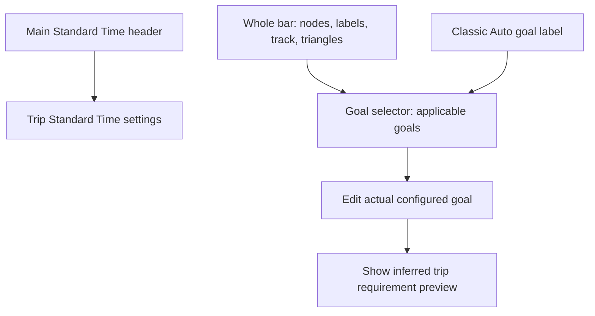

# Percentage display

Settings → Percentage display offers Classic and Goal bar beneath Clock/Timer
Settings. Classic remains the default. The saved account setting is
`wmof.clock.percentageDisplay` (`classic` or `bar`). Publisher snapshots carry
`viewData.percentageDisplay`; Drop-In uses the same renderer and model.

## Idle and active states

With no active trip, the scale starts at 0% and ends at the highest configured
goal, capped at 150% (including Standard at 100%). Nodes use the configured Trip
and overarching aggregate percentages, not inferred requirements. There is no
Current node and no time labels. Standalone breaks use this same no-standard
presentation. `goal_bar.active` distinguishes it from the active projection.

Starting a trip replaces aggregate values with inferred trip
requirements. Ending it restores the configured values and clears stale failed
states and times. Drop-In follows the same snapshots. Loading an existing trip
must select the active projection after restoration, not treat it as a new start.

## Model and time meaning

`ClockTimer.getGoalBarSnapshot()` always supplies Standard (100%) and, during an
active trip, Current's counted trip percentage. Trip mode adds only the manual Trip
goal. Day/Week/Money/Month/Year/Custom modes add only the selected aggregate's
inferred trip requirement, with no Trip goal node. Auto includes both Trip and the
selected aggregate. The same visibility rules apply to idle configured goals.
Hidden goals do not participate in failure markers, retained failed nodes or the
failed-goal selector. All active node percentages and times describe the current
trip, never aggregate elapsed history or raw aggregate percentages. The configured aggregate goal and its inferred trip requirement are
different: a Day goal of 110% can require 125% on this trip. Editors retain the
configured overarching value. Calculated requirements may exceed 150%; do not
clamp those calculations to the input limit.

Visible goal units and Current show their exact inferred-trip percentage. Equal
goals share one label stack and a short linked-station shape. Time sits directly
above percentage, both below the bar, with one connector. There are no goal-name
captions or tick marks. If time is undefined (idle or standalone break), the empty
time row collapses and the percentage hugs the node. Standard is a dashed line;
Current is a double solid line. Standard has no separate label: a configured or
inferred 100% goal supplies a shared stack pinned beneath the Standard line. Its
connector is omitted. The bar outline is white, 2.5px, drawn above its fill.

The selected target's label stack has a border. Border ownership follows every
recalculation and state transition. Equal visible Trip/aggregate values put Aggregate on the right
of the merged unit, following Aggregate > Trip > Standard target priority. A changed goal's label fades/moves on split; merging reverses
that motion. All labels fit inside the available width, respecting the fixed
100% anchor and actual border widths. Shared units fail and move as one unit.
Responsive fonts, marker radii and track thickness grow with the real available
space. Both visible vertical gaps around the percentage group are balanced;
the Sync button remains centered on the track itself.

Each goal's counted position is `tripStandard / (inferredTripPercent / 100)`.

**Remaining mode uses Standard as zero**, independently of the active goal:
`nodeRemaining = tripStandard - nodeCountedPosition`. Current uses
`tripStandard - tripCountedElapsed`. Standard is therefore always 0:00 remaining;
Current reaches 0:00 when its percentage reaches 100%. The main time readout uses this same calculation and exactly matches Current
in the selected time mode.

For a 30-minute standard, 100%, 110% and 125% correspond to counted positions
30:00, 27:16 and 24:00. Their bar Remaining values are 0:00, approximately 2:43 and
6:00. Current at 150% means 20 counted minutes and 10:00 remaining against Standard.
The existing formatter supplies the exact displayed rounding and sign. Below
100%, Current has negative Standard remaining.

Elapsed mode shows counted trip positions, without aggregate elapsed history.
Standard's 100% node shows the trip standard duration (30:00 in this example);
Current shows counted trip elapsed and coincides with Standard at 100%.
End Time uses each node's trip counted position and the existing trip deadline
formatter. Current uses its own counted trip position, not the main selected
scope's goal deadline.
Elapsed/end values increase right to left; Standard-based remaining values
decrease right to left. Break and Down pauses retain counted positions while
deadlines account for the pause.

## Geometry, states and motion

There are no tick marks or circle markers for Standard/Current. A left-pointing triangle marks a compressed lower range.
A right-pointing triangle appears whenever one or more goals have failed, including the
all-failed layout. Idle and all-failed scales start at zero, so they have no left
compression marker. Both markers sit outside the node track with reserved
horizontal space so they do not overlap node borders or the Sync button. Unused leading range contracts while goals
remain. Current occupies the right edge; the lowest remaining goal anchors the
left. Circle collisions produce touching opaque nodes, using radius plus half the
computed stroke width for each node. Focus changes trigger refitting, and miss
pulses expand inward to preserve the outer collision boundary. Labels have their own
horizontal packing and leader lines so long times do not force node overlap.
Connectors follow the final collision-adjusted marker and label positions.

On failure, labels fade and the failed node moves off the right edge. Stable
node IDs preserve motion through recalculation; interrupted animations start
from visible positions. When every goal fails, retain the last goal at the right
with any 100% goal sharing the Standard reference label; Standard alone remains unlabelled. That scale runs from zero at the
left to Standard's 100% at the right, with Current placed proportionally.

The bar uses the user's productive Trip/B-game/Overtime colors, ignoring Break
and Lunch colors. Down colors the segment to the right of the next target.
Elapsed color occupies the right-hand segment. When all goals have failed,
Overtime runs from Current to the retained failed goal at the right edge; the
left portion stays unfilled. Down replaces that segment color during Down. Display changes
animate height/opacity; Sync's fixed column enters/leaves and the bar refits.
Reduced-motion preferences suppress node travel and pulses.

The bar model is opt-in via the timer's `goal-bar` attribute. Classic ticks do
not calculate the extra snapshot. Both views share the whole-bar goal-selector action;
Drop-In actions remain subject to its existing control permissions.

## Goal input limit

Pointer and voice goal entry above 150% updates to 150% and displays an
informational notice. The first spoken sentence is, for example, “Day goal
changed to 150 percent.” Auto/Sync recalculation feedback follows it. A batch
holds announcement playback while scope totals resolve; priority applies only
to announcement ordering, not execution of unrelated command slots.

The notice is a `data-speech-passive` dialog. It does not acquire command ownership
or block the command buffer awaiting acknowledgement. Subsequent commands in
the same utterance continue through their existing contexts and dependencies.

## Other shared layout rules

Idle Auto displays `[Auto]`; during a normal active trip it displays its target,
such as `[Day]`. The clock region has no idle spacer above it. Its explicit
zero-minimum grid tracks keep the clock vertically centered between the upper
action controls and the visible Log/Mic boundary, including during resizing.
When neither lower control is present, the content area's bottom is the boundary.

Validation: `goal-bar.mjs`, `goal-bar-browser.cjs`, `clock-centering-browser.cjs`,
`app-state-transactions.mjs --goal-limit --voice-feedback`, and existing counted
accounting, goal-feedback and Classic percentage-layout tests.

## Proposed lifecycle animation sequences

The idle/active data above is implemented. The following sequences specify the
next animation pass; existing generic movement is not the complete lifecycle
choreography yet.

| Trigger | Sequence | Approximate duration |
| --- | --- | --- |
| Cold load, no trip | After settings and session restoration settle, fade in track and configured nodes at their final idle positions. Times and Current never appear. | 200 ms |
| Cold load, trip already running | Wait for the restored trip, goal calculation and interval state; fade directly into its current inferred layout, time mode, pause color and failure state. Do not briefly display idle goals or replay start/failure animations. | 200 ms |
| Start committed | Retain goal node identities. Move nodes and rescale from 0–configured maximum to the inferred active range. Crossfade configured percentages to inferred values. Introduce Current at the active right edge; then fade in valid time labels. Animate Sync width concurrently. | 400 ms movement; 180 ms label fades |
| End requested | Keep the active layout and live data while confirmation/persistence is pending. Cancel or failure leaves the active view intact. | No end animation yet |
| End committed | Fade out time labels and Current. Restore missed goals as neutral nodes, expand to the idle 0–maximum scale, move all goals to configured positions and crossfade their values. | 180 ms fade, then 350 ms movement |

Timing details:

- Start: move nodes from 0–400 ms; crossfade values over the first 180 ms; fade
  Current in from 100–280 ms; fade times in from 220–400 ms. Render the latest
  valid time at fade-in, rather than interpolating time strings.
- End: fade Current and times from 0–180 ms; from 180–530 ms restore the idle
  geometry and neutral goal appearance, crossfading configured values during
  the first 180 ms of that movement. Never show invented idle times.
- No numerical count-up: percentage text crossfades between exact values.
  Position motion supplies continuity without showing values that were never
  calculated. Stable slot IDs remain `standard`, `trip`, `total`, `current`.
- Commit, not button press, triggers start/end. Rendering never awaits or blocks
  command execution, persistence, announcements or countdown ticks.
- An authoritative restored snapshot determines the first visible layout. If
  hydration takes longer, keep the track hidden or neutral; never flash an idle
  layout before discovering an active trip. A restored Lunch/Down trip retains
  its pause state and live clock calculation.
- Recalculation or a new transition during movement cancels obsolete endpoints
  and retargets from visible geometry. Failed-node history resets for a new trip,
  not on every tick or mode change. Restoring a session emits no historical
  failure pulses. A rejected stop never emits an idle snapshot.
- Label packing and touching-node rules apply at both endpoints and during
  crossings. Use separate vertical arcs for crossings while labels crossfade;
  settle into one compact row. Sync retains its fixed icon size and cloud
  alignment while its column changes width. Clock centering follows the new
  available region throughout the transition.
- Reduced motion applies final geometry immediately with no travel or pulses;
  optional opacity fades are at most 100 ms.

Acceptance checks for that animation pass: cold idle load; cold active load;
restored Lunch/Down and all-failed sessions; start/end commit versus rejection;
new trip during an unfinished end animation; goal edits during motion; short
screens; Sync appearing/disappearing; Drop-In attaching midway through a trip;
and reduced motion. Assert no idle time labels, no active-load idle flash, no
historical failure replay, and final positions matching the model snapshot.

## Whole-bar goal selection

The entire bar is one click/touch/Enter/Space action. Track, blank area, Standard,
Current, labels and both compression triangles all use the same shared action. A single applicable goal opens its numberpad directly; Auto with multiple goals opens the existing configurable selector.
Trip offers Trip only; aggregate modes offer that aggregate only; Auto offers both.
Failed goals remain selectable. Failure count does not change the offered choices.
The separate Sync button retains its own action. Standard Time is never offered
here and Current no longer changes time mode. Standard Time editing remains on its
existing main control. The bar has one keyboard focus target.

The selector and numberpad show the configured goal in larger type and Inferred Trip Goal in smaller type.
Classic uses the same details. Actual is the stored, editable percentage; inferred
is the current-trip requirement, not the stored aggregate goal. Editing previews
inference without changing stored settings; confirmation uses existing persistence,
locks, 150% input cap and announcements. In the selector, aggregate options show “Day Goal: 110%” and, during an active trip, a smaller “Inferred Trip Goal: 125%” line. Trip options show only “Trip Goal: 110%”. With no active trip the inferred line is omitted entirely, and the remaining text stays vertically centered.
Drop-In uses the same model and details with existing observer permissions.

## Main Standard Time display

The main UI always projects the current trip's Standard Time, independent of
Trip, Auto, Day, Week, Money or other aggregate selection. Its label is simply
“Standard Time”. Aggregate standards remain available to accounting and reports;
they never replace this main value. The main Standard Time button opens the same
trip editor in every active-trip scope, including Down and scheduled breaks.
Standalone breaks still have no associated standard. Drop-In follows the same
shared state projection while retaining its existing read-only publisher control.

## Focused editor flow

This graph describes action routing, not new persistence semantics. The
[working FSM](mainline-fsm-draft.html) includes guarded editor states and the
[goal/editor SVG flow](goal-display-fsm.svg) is its generated visual projection.

Active main time readouts also stay trip-scoped in every percentage mode: Trip
Time Elapsed, Trip Time Remaining and Trip End Time. Remaining uses Standard as zero in both the main readout and bar Current. Idle aggregate
banked/over summaries and aggregate accounting remain unchanged.

## Counted-time motion proposal (not implemented)

Use counted trip time as the motion coordinate and keep the scale stable between
semantic transitions. Freeze the visible animation immediately on interval entry.
Prepare/revise keyframes during the interval; resume from the frozen position with
a fresh counted-time anchor. Goal, mode and layout changes invalidate stale plans.
During Down, a future End Time presentation can use end-at-pause plus elapsed
Down duration, derived from timestamps so backgrounding cannot accumulate drift.
These motion and Down End Time proposals are not in the current implementation.

The main active time value and bar Current now share the same formatter and
interval annotation in Remaining, Elapsed and End Time. Aggregate selection and
goal changes cannot change this Current readout. Goal deadlines and budgets remain
separate accounting/target-node values. This fixes the mismatch reported in EVQT6K.

Aggregate selector titles include the configured percentage: `Day - 115%` or `[Week] - 120%` when targeted by Auto. Idle Auto remains `[Auto]`. The numberpad is touch-only and fills the visual viewport; the mic bar slides out on entry and back on exit if previously active. Switch to Voice explicitly leaves touch input.

## Shared avatar and four-layout presentation (2026-10-28)

`GoalBarAvatar.js` and `GoalBarAvatarAssets.js` are the shared presentation for
Order Filler and Drop-In. The [interactive reference](goal-bar-avatar-preview.html)
uses these production modules. It is a projection of existing trip/interval state;
it never dispatches commands or changes timing/accounting.

* Idle (no trip and no standalone break): upright Walking across the bar. Arms
  swing with a relaxed backward forearm, using compact 6.5/5.5-unit arm segments.
  Turns take 1.2 seconds; limbs continue through the turn without frozen holds.
* Any running trip, including non-production: left-facing running cycle above
  Current's double line, with a clear gap beneath the feet.
* Break, Lunch or Short Break, including standalone: chair enters from the right;
  the shared hip/leg rig turns to a left profile and sits. Both legs overlap when
  seated. Standing reverses the morph while the chair slides right. Body strokes
  stay solid white; the last attempted Down-proportion matching was reverted.
* Down: raised elbow below shoulder, continuous fast forearm shake, no hand nub.
  Only expletive symbols animate inside the stationary bubble. Its tail points
  toward the character and the bubble changes side when edge clearance requires.
* Break → Down and Down → Break have distinct source-exit and destination-entry
  stages, without a running pose between them. The forearm shortens while lowering.
* First projection after reload or restoring a hidden view runs destination entry
  only. It never plays a fabricated source exit or historical finish celebration.
* Successful active-session completion: lower arm or stand as needed, show the
  black/white flag in front (left), nod, emit one pastel burst, fade to Walking.
  The cloth flaps while the pole remains fixed. `canvas-confetti` 1.9.4 supplies
  randomized gravity/drift/decay and timing; its launch is centered on the bar.
  Repeated snapshots cannot replay the same session's finish feedback.

Avatar animation cancellation, display changes and visibility changes do not
block application operations. Reduced motion uses settled poses, no travel and
no confetti. Classic does not render the avatar or celebrate hidden completions.
The graph's presentation states are subordinate to the existing business FSM.

Full/Classic, Full/Bar, Compact/Classic and Compact/Bar switch through the shared
layout transition controller, including interrupted choices and reduced motion.
Compact uses centered monochrome SVG icons, with an outlined checkered finish
flag. Its Break/Short Break/Lunch/Down Timer is above the percentage group. In any
active trip's Break/Down, main Elapsed/Remaining text turns gray; End Time stays
normal. Standalone breaks are exempt. Full Down controls keep their original
230px height (156px on short screens), with extra space assigned to surrounding
gaps. The section's outer background follows the rounded control edges.

Early break completion and unused credit (2026-10-28): live trip readouts use
`summary.trip.countedTimeBalanceMilliseconds`, which can be negative when unused
break allowance exceeds productive time. Persisted counted durations remain
nonnegative. Remaining is Standard minus that signed balance; Elapsed displays
the signed balance; Current End Time keeps ticking. This applies equally to
Break, Short Break and Lunch, including ending inside the start buffer and
restoring the event history. Current percentage uses earned Standard plus credit
divided by productive time, even if the signed bank coordinate is negative. Only
zero productive time makes Current unbounded; its double line and runner stay
visible. A negative bank coordinate must not freeze time or erase finite performance.
Regression: `tests/early-break-readout-browser.cjs`.

Follow-up regression fixes and buffer presentation:

* Overtime projects productive segments only, excluding inserted pauses, both
  break buffers and overwrite-owned spans. Live overtime bounds commit without
  replaying growth tweens, including after event restoration in fitted/overflow.
* Ending a standalone break returns the avatar to Walking with no finish pose or
  confetti. Only ending an active trip celebrates.
* Main time captions are Time Elapsed, Time Remaining or End Time. Down's bubble
  retains its navy/yellow colors. Default header height is 52px, contracting to
  42px on short screens.
* Idle Auto highlights the highest configured goal after a merged goal splits.
  Percent-only target frames use measured text bounds for vertical centering.
  Goal selector choices follow bar percent order and its selected-goal tie rule.
* `interval_state.buffer` is null outside buffers. During a start/end buffer it
  carries phase, durationMilliseconds and remainingMilliseconds for that buffer,
  independently of the overall break countdown. Full and Compact mirror two
  countdowns at 25%/75% of the timer area, centered vertically on its caption and
  value. Their fills recede inward, disappear for the main break, and return for
  the end buffer. Reduced motion updates without interpolation.

Additional regressions: `tests/overtime-break-browser.cjs`,
`tests/break-buffer-layout-browser.cjs`, avatar and merged-unit browser checks.

Bank/work correction: Trip Log and Trip Summary Actual now render the separate
productive duration, never a zero-clamped bank balance. Unused break/buffer credit
continues to increase the bank; surplus carries into subsequent aggregate-goal
budgets exactly once. Main bar/live bank-coordinate behavior is unchanged.
See time-range-model.md, Productive Actual and bank credit are separate.

Pointer-region correction: only the painted track, markers, compression arrows
and their value labels open goal editing. The runner/avatar and empty vertical
space are decorative and pass pointer input through. The main time label remains
above the bar for hit testing. The SVG remains a single keyboard goal-edit action.
At 100%, Trip and aggregate targets keep their real names in display and speech;
Standard naming applies only to the actual Standard fallback.

Active Trip nodes use the effective synchronized goal, including the Goal Bounding
floor and raw-goal fallback policy; idle nodes still use configured goals. Changing Goal Bounding recalculates
the node immediately. Editors continue to edit the underlying configured goal.
Current percentage reserves a measured widest-digit width for its integer-digit
band plus two decimals and the percent sign. The displayed value is unchanged.
The band shrinks at 1000→999, 100→99 and 10→9; digits and font metrics are measured
from the actual rendered font instead of assuming that 8 is widest. Time text may
remain the wider constraint for a stacked label. Goal-selector option spacing is
16px above and below the options.

Label stacks are bounded by the outermost track, node or continuation-arrow edges, not by the SVG viewport. A label that would protrude moves inward with its connector; its marker keeps its position. The complete track/node/arrow extent stays centered beside Sync. The 100% anchor remains centered under Standard.

The large Time Remaining readout above the bar also uses Standard minus counted trip time (100% is zero). A missed goal or target change must not reset that baseline. The Sync control is visible only when the selected mode is Trip; Auto hides it even when its current target is Trip. The shared Order Filler/Drop-In layout collapses the hidden column.

Both compression arrows contribute to horizontal centering. Label stacks and target boxes (including their border stroke) are nudged inside the outermost track/node or continuation-arrow edges. When an arrow is present, its horizontal extent gives boxes extra room beneath it.

Low-goal regression: Auto with Day 40% and Trip 100% must keep fonts readable as Current approaches 100%. Reserve label room on both sides of the Standard/100% anchor instead of progressively shrinking all text. Resolve node crowding from the right so a distant left goal does not drift. A failed 100% goal retains its marker but omits details while another goal remains available; its details return only for the all-failed fallback. Retired transition text must release its width reservation.

Goal Bounding and fractional-time contract: see [goal-bounding-and-counted-bank.md](goal-bounding-and-counted-bank.md).
The upward triangle marks an actively raised inferred Trip requirement, the downward
triangle a below-floor target in use. Merged goal units preserve these indicators.
Releasing the bound retains the underlying candidate, animating its position, label
and target border through the existing merge/split and target-transfer machinery.
Time captions remain mode-switch controls, with no extra popover action.

Idle 100% labels follow the normal outer track/node inset, including the target
frame border and the available width beside Sync. The 100% label stays centered
on Standard only during an active trip; idle endpoint markers remain at their
scale position while the text stack moves inward. This rule is shared by Drop-In.

Avatar surface following: the shared renderer passes painted track thickness and
visible goal-bubble bounds to the avatar. Feet travel just above that surface, with
smooth cosine approaches over goal bubbles, and merged units; Standard and Current lines do not raise him.
Idle travel keyframes share the same elevation profile in both directions; layout
changes retain the travel phase. Running, Down, finish and the complete chair rig
use that same surface calculation. Labels and invisible hit areas do not lift the
man. Reduced motion places him directly at the destination without travel.
Selecting Auto announces “Auto Mode”; other scope announcements retain “Viewing …”.

As the Current line approaches a goal bubble, the same surface envelope raises
the man before overlap, then lowers him once clear. The entire chair rig follows
that elevation. Compact Trip Log inherits its regular button colors.

Active-trip tick scale: paint a tick at every visible multiple of 5%, up to 150%,
inside a rounded clip inset from the track border. Paint ticks below node units;
no tick labels or external stems. On positive active ranges, both nodes and ticks
project reciprocal percentages (`Standard / ratio`) to counted-time distances.
For example, 120% lies halfway between 100% and 150% on this scale. Preserve the
explicit finite 0% origin for idle/all-failed fallback layouts. Existing ticks
retain their identity during movement; entering/exiting ticks fade, with clipping
maintained through the entire transition. Reduced motion settles immediately.

Startup keeps percentage and action controls invisible until saved layout settings
are resolved. Resuming a landing-page session also waits for account settings;
failed requests release the gate to the fallback layout. Login, header and speech
controls remain available. Full/Compact and Classic/Bar transitions share a
translucent Switching Layout status overlay, retained through queued changes and
removed on success or failure. Reduced-motion changes still clear busy state.
Buffer bars reach the padded page edges with the same inner gap to the combined
break caption/time group. They are borderless, vertically centered on that group,
and one-third its height. Each countdown stays halfway between the padded page
edge and timer group, centered vertically in a rounded contrast card.

Audio Settings is the first Settings submenu action. Adjacent display-setting
groups share one separator. The Full Trip Log unpin transition is scoped away
from Compact controls, so Compact pin/unpin retain their opacity/scale transition
and the other information buttons recenter smoothly.

Substandard ticks remain visible with Goal Bounding disabled, including while Current exceeds 100%. With Goal Bounding enabled they stay hidden until Current drops below 100%. Lower ticks use a compact reciprocal band; all ticks stay inside the track and beneath goal nodes. Continuation triangles sit outside both the track and node extents with a visible gap. Active avatar poses and the seated chair share an anchor 20px left of Current; obstacle clearance covers their full footprint.

Switching Layout uses a manual top-layer popover above the open hamburger/settings menu. Its existing queue owns dismissal and aria-busy restoration; a large document z-index alone cannot cover menu popovers.

During a running trip, Full/Compact Bar layouts use the shared interval-timer slot for the next unfailed goal deadline. Coincident goals share a slash-separated caption (Week/Trip); Standard is omitted when a named goal shares its percentage. The countdown uses the goal deadline, floors whole seconds and appends the shared fractional correction superscript. Standard-based main readouts remain unchanged. Break/Down timers take priority during intervals; Classic, idle and all-goals-failed states omit the countdown.

In Full mode the timed End Lunch/End Break/End Short Break button restores one large inline label/countdown group centered between its buffer bars. Compact interval captions and countdowns remain stacked. Buffer sizing follows the combined inline group bounds.

Full break text stays on one line and uses its larger available font when buffer content is absent. Buffer text reserves side space only while a buffer is visible; fitting prevents clipping when the button itself is constrained.

Compact Down entrance at end-buffer expiry uses the rail fade/scale transition; the legacy Full slide is restricted to Full mode. The balanced percentage row stacks above the empty clock container so its goal control remains clickable after switching layouts.

The next-goal countdown resolves aggregate identities through the current localized range caption (Day, Week, Year, etc.), matching the bar; it does not expose the internal Total fallback. Merged captions use that same name, e.g. Week/Trip. Fractional markers are absent at exact whole seconds and zero; positive floored countdowns append + only when milliseconds were omitted.

Layout-option selection uses the applied `aria-checked` state. Selected Classic/Goal bar and Full/Compact radio buttons retain their selected fill and border while hovered or keyboard-focused; generic menu hover/focus decoration must not obscure selection after Switching Layout closes. Browser verification covers all four options without reopening Settings.
