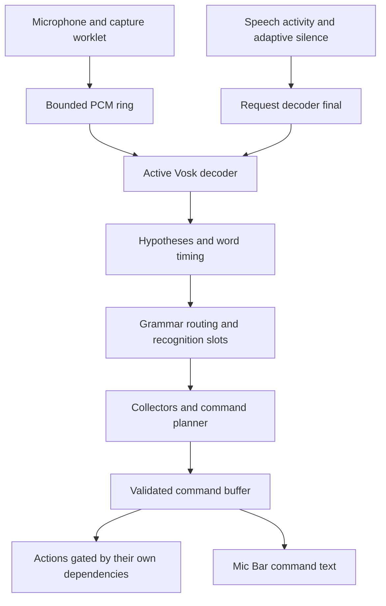

# Current speech implementation

This guide describes the runtime in **I0462X**, production commit
`bb6cd93b6712c03be6282b800ace3e183bb6c45d`. On October 23, 2026 the user reported
it was “very stable with almost no lag.” That is observed production feedback,
not a latency guarantee for every device. Documentation-only deployments may
have a newer build ID while retaining this runtime behavior.

Keep [the stable release reference](stable-release-reference.md) as the exact
comparison point for future changes. Implementation history and detailed audio
boundary rules are in [Vosk context handoffs](vosk-context-handoffs.md).

## Microphone controls

There is no voice command to stop recognition or close the Mic Bar. Standalone
`off` is retired from the system menu and language pack. The microphone button
still explicitly stops capture. `sleep` keeps capture running for `wake`.
`speech off` only disables spoken announcements; `sync off` changes Sync. Neither
stops recognition. Background recovery must continue to preserve that intent.

## Active architecture

The default backend is local, client-side Vosk with sequential context recognition.
One microphone and one 16 kHz mono Float32 capture stream feed a bounded PCM ring.
One active decoder receives audio at a time. Up to three prepared idle decoders
share the loaded model; idle decoders receive no microphone PCM.

| Component | Responsibility |
| --- | --- |
| [SpeechMenu.js](../SpeechMenu.js) | Capture lifecycle, available command declarations, planning, ownership, duplicate checks, and dispatch into the buffer. |
| [VoskContextRecognizer.js](../VoskContextRecognizer.js) | Sequential decoder routing, retained audio, replay, preparation, decoder epochs, and readiness diagnostics. |
| [VoskRecognizer.js](../VoskRecognizer.js) | Shared model loading, native decoder communication, alternatives, audio draining, and final-result requests. |
| [VoskGrammarRouter.js](../VoskGrammarRouter.js) | Command/value stages and declared continuation contexts; no business action execution. |
| [SpeechGrammarCompiler.js](../SpeechGrammarCompiler.js) and [its worker](../speech/SpeechGrammarWorker.js) | Finite grammar preparation and compact phrase-table transport. |
| [SpeechRecognitionLedger.js](../SpeechRecognitionLedger.js) | Sample-addressed recognition ownership and next-type forecasts. |
| [SpeechLanguageController.js](../SpeechLanguageController.js) and [SpeechValueCollector.js](../SpeechValueCollector.js) | Locale-specific interpretation through a shared contract, value continuity, bounds, and classification. |
| [ValidatedCommandBuffer.js](../ValidatedCommandBuffer.js) | Accepted command work, execution dependencies, completion, cancellation, and transcript lifetime. |
| [StateTransactions.js](../StateTransactions.js) and [app.js](../app.js) | Application effects, action policy, persistence, and rollback where enabled. |
| [SpeechMicBar.js](../SpeechMicBar.js) | Readiness and validated-buffer presentation; no independent transcript dispatcher. |

The pinned browser runtime is `vosk-alternatives-607b5c3e.js`; the default model is
`vosk-model-small-en-us-0.15.tar.gz`. A server, Web Speech, and other adapters remain
explicit comparison options. Their presence does not mean production audio is
being sent to a speech service.

## Audio continuity and decoder transitions

Capture stays open across logical utterances. Closing a logical utterance asks
for a final result; it does not close the microphone. Incoming audio is copied
immediately because capture arrays may be reused. Default retention is 30 seconds
(1,920,000 bytes of mono 16 kHz Float32 PCM). Overflow or expired required audio is
an explicit failure, not silent truncation.

Native word timestamps become absolute stream sample ranges using the decoder's
origin. [SpeechBoundaryAnalyzer.js](../SpeechBoundaryAnalyzer.js) claims a one-use
destination, clears the pending reference, and chooses a conservative replay start
before the semantic boundary. Defaults preserve at least 120 ms of context and
search up to 300 ms backward for quiet audio. Analysis does not wait for future
silence and does not decide when the utterance ends.

A transition retires the active decoder, selects a prepared decoder or creates a
successor with a fixed grammar, and replays retained audio from the selected sample.
It does not mutate a live decoding graph. Epoch checks reject callbacks from retired
decoders. Replayed words are reconciled by audio position, not equal text, so repeated
digits remain meaningful. Untimed partials do not receive invented sample ranges.

## Grammar, language, and continuations

DOM speech attributes and application action metadata describe command patterns,
availability, value fields, execution contexts, and next contexts. The language
controller supplies recognition vocabulary and parsing through the same locale
contract. See [the language controller guide](speech-language-controller.md).

Acoustic lookahead follows installed `speech-chain-next` / `speech-chain-context`
links, with a bounded two-level expansion in the sequential adapter. Login also
includes installed continuation vocabulary so an uninterrupted credential-plus-command
recording remains audible. This vocabulary is generated from application declarations,
not sample IDs, PINs, or recording scripts. Availability and authorization are checked
by the planner and again at execution.

Grammar projection **must not await a command's completion barrier**. The command
may itself need the recognizer's final result. Speculatively running the whole planner
for every possible future command also reintroduces preparation delays. Acoustic
lookahead therefore uses declared context links; actual recognized input is still
validated by the live planner.

A complete value may still have continuations. For example, “an hour” can grow into
“an hour and five.” Time, duration, digits, and percentages retain distinct contexts.
Speech activity and adaptive silence determine the logical boundary. On timeout,
the processor assumes no further continuations and drains the decoder before settling
the remaining input; it does not pretend the last partial was the final result.

Before login, unmatched leading speech must not poison the credential collector.
The router preserves the earliest available command head or digit start. Unmatched
command words and chatter before that point may be discarded; available commands
retain normal eligibility and effects. The first digit begins incomplete bounded
collection immediately. Extra digits in one continuous run must not be trimmed to
manufacture an accepted field length.

Discarded prefixes are reconciled against native final word timings before the
sequential adapter advances the stream boundary. Credential slots begin at their
actual audio samples, excluding discarded words. Handoff diagnostics include
`discardedPrefix` text and sample bounds. Following credentials and commands stay
on the active stream; Sleep, Cancel, authorization and duplicate checks retain
their existing rules. This primary-transcript resynchronization does not allow
searching lower-ranked alternatives for otherwise invalid commands.

## Alternatives and duplicate reconciliation

The default native maximum is 10 alternatives, configurable from 1 through 30.
The adapter preserves native rankings and available timing/confidence data. Selection
probes eligible command interpretations without executing actions. It does not invent
homophone aliases or search past discarded junk for a command. While sleeping,
selection considers only the primary hypothesis for wake activation.

The common duplicate guard uses command identity plus its captured execution context.
The default execution context is null; ID and PIN use different contexts. Revised
interims and the later browser/native final therefore cannot execute the same command
again merely because wording changed. A reconciled duplicate is successful completion
for dependency purposes, not an invalid prerequisite.

## Recognition slots versus execution slots

Recognition slots describe what a decoder owns in the audio: stream identity,
start/end samples and bytes, decoder epoch/origin, type, semantic context, command
identity, and a possible next-type forecast. Their ownership states are `locked` and
`sealed`. A forecast such as Ready At → Time constrains the next value slot.
An asynchronous ownership proposal is rechecked against current context and source
revisions before committing. Ownership alone never executes a command.

Execution slots describe accepted work. Their `status` is one of:

| Status | Meaning |
| --- | --- |
| `pending` | Accepted or declared, with prerequisites not yet satisfied. |
| `executing` | The command's executor is running. |
| `resolved` | The slot completed successfully, including a reconciled duplicate. |
| `invalid` | The slot failed or was canceled; its dependents cannot proceed. |

A value slot links to its command head through `ownerHeadSlotId`. Dependencies carry
slot identity and kind, and ranges use stable `startSlotId` / `endSlotId` endpoints.
Snapshots expose `waitingForSlotIds` and `invalidDependencySlotIds`; there is no
separate resolved boolean. Existing buffer entry presentation statuses remain a
separate compatibility API from these four execution-slot statuses.

The buffer executes unrelated ready work asynchronously. It waits for specific
prerequisites rather than blocking an entire utterance. Current action policies use
`speech-slot-key` and `speech-wait-for-slots`:

| Action family | Published slot | Waits for |
| --- | --- | --- |
| Combined credential login / PIN authentication | `authentication` | Its required login workflow prerequisites. |
| Four-digit ID staging | `login-id` | Its required login workflow prerequisites. |
| Goal reads/settings | `goal` | An existing authentication producer and earlier Goal work. |
| Sync / Sync Override | `sync` | An existing authentication producer and earlier Sync work. |

Goal and Sync do not wait for each other. Their action metadata opts out of the
compound state transaction so rollback of unrelated work cannot undo an independent
setting. Recalculation uses current application state. Other dependent workflows retain
their declared ordering, authorization checks, and transaction/persistence rules.
A missing named producer is not an authorization grant; live action availability still
applies. A failed prerequisite invalidates only its dependents.

## Capture closure and final-result ownership

A requested final belongs to its original capture ID even after capture ends. Starting
another utterance must not discard that pending final merely because it has not yet
produced a validated command. Explicit cancellation, session changes, and authorization
fences remain effective.

Release the owned final-result fence immediately when the final arrives, **before**
awaiting action or segment barriers. Otherwise a command can wait for a final while
final handling waits for that command. Login tails are planned after successful
authentication even when their capture is already closed. Authentication failure must
not grant execution to the trailing commands.

## Preparation, caching, and readiness

Finite grammar compilation runs in a dedicated worker where supported. Protocol 2
sends phrase-table references and reuses finite vocabularies already held by the client,
instead of cloning large numeric arrays per path. The worker URL is versioned for the
protocol. New workers return the legacy result shape to old callers; new callers accept
legacy replies from cached workers. Unsupported Worker environments use the existing
main-thread compiler fallback.

Syntax caches are bounded and do not cache permissions or availability. Context
snapshots are versioned and invalidated by state changes. Obsolete unprocessed partial
inspections can be coalesced; finals retain their ordered handling. The decoder pool
prepares idle decoders without feeding them audio.

Readiness phases are `idle`, `preparing-grammar`, `preparing-decoder`, `replaying`,
`decoding`, and `finalizing`. Preparation, replay, and finalization show Processing;
ready idle capture or decoding returns the Mic Bar to Listening. Capture being open
and a decoder being ready are separate facts. Readiness presentation must not change
command availability or remove login vocabulary. `executionDiagnostics` exposes the
phase and phase age, with audio delivery and queue metrics available separately.

Mic Bar command text comes from the validated command buffer, not raw interim/final
text. It remains while accepted work is pending. The default idle transcript timeout
is 2,000 ms after pending work drains; `speech-transcript-timeout` and the existing
response-timeout fallback can override it, including persistent/manual modes.

## Diagnostics and validation

[Drop-In speech debug](drop-in-speech-debug.md) exposes bounded events for hypotheses,
selection, typed values, slot ownership/dependencies, command execution, readiness,
and preparation/queue timing. It is opt-in and suppresses publication while the login
dialog is open. Audio samples and arbitrary action arguments are not serialized.

Key regressions in the deployment workflow include:

- `tests/app-state-transactions.mjs --decoder-readiness-ui --voice-feedback`
- `tests/app-state-transactions.mjs --delayed-final-owner --voice-feedback`
- `tests/app-state-transactions.mjs --decoder-final-boundaries --voice-feedback`
- `tests/app-state-transactions.mjs --login-final-tail --voice-feedback`
- `tests/speech-failfast.mjs`
- `tests/validated-command-buffer.mjs`
- `tests/speech-latency-support.mjs`
- `tests/vosk-context-handoff.mjs`
- `tests/vosk-collector-browser.cjs`

Private human-audio replays cover the eight-digit login plus Goal / Sync / Ready At
chain and Break Start Lunch Okay, including CPU-throttled runs that require completion
without a follow-up utterance. Keep source recordings outside Git. For the full-chain
benchmark, measure the validated time's planner event relative to an independently
reviewed speech-end sample; WAV trailing silence, playback end, action completion,
and announcement completion are different measurements.

## Pending local update: returning from the background

An ended client-owned microphone track is an interruption, not an intentional Off.
The Mic Bar stays open in Reconnecting. Foreground visibility, pageshow, and focus
coalesce recovery; capture is not reacquired while the document is hidden. Resume
a live suspended/interrupted AudioContext, or replace an ended/muted track and its
capture graph. Keep the existing recognition model, decoder and validated command
buffer. A partial capture is finalized before the next capture begins.

Readiness is confirmed by PCM delivery from a live, unmuted track before emitting
`speechCaptureRecovered`. Permission or delivery failure keeps the bar open with
retry feedback. Explicit Off and pre-login expiry prevent automatic recovery;
session-generation checks dispose of late capture results. The browser-owned Web
Speech adapter retains its separate recovery path.

Awake recovery announces “Microphone reactivated.” Sleeping recovery remains asleep
and announces “Microphone deactivated.” Stop the old reminder timer while that
announcement plays, then start a fresh 60-second cadence after it finishes. A normal
return with healthy sleeping capture follows the same announcement/timer reset.
Visibility/pageshow events are deduplicated; leaving again or waking cancels stale
reminder scheduling. Drop-In releases the old microphone clone on interruption and
refreshes it after capture recovers.

`tests/microphone-background-recovery.mjs` covers frame-backed readiness, retained
decoder/Sleep, event coalescing, permission retry and explicit-Off fencing.
`tests/app-state-transactions.mjs --mic-feedback --voice-feedback` verifies the
announcements and that the reminder restarts after speech completion.

## Configuration and experimental paths

Per-visit comparison settings are defined in [speech/VoskTestConfig.js](../speech/VoskTestConfig.js):

| Query option | Current default / effect |
| --- | --- |
| `speech-backend` | Defaults to local `vosk`; explicit adapters are comparison options. |
| `speech-recognizers=sequential` | Default recognition mode. |
| `speech-recognizers=parallel` | Experimental simultaneous decoder mode; not this stable baseline. |
| `speech-handoff=off` | Selects the original continuous adapter rather than sequential context handoffs. |
| `speech-warm=off` | Disables the prepared idle decoder pool. |
| `speech-grammar-worker=off` | Uses main-thread grammar compilation for comparison. |
| `speech-coalesce=off` | Disables partial-inspection coalescing. |
| `speech-alternatives=1..30` | Native alternative maximum; default 10. |

Dynamic activation/deactivation of selected parallel recognizers was discussed as a
future option. It is distinct from the current pool of idle prepared decoders and from
the experimental all-decoder mode. It has not been implemented in I0462X. Server-side
recognition remains a [deferred experiment](speech-experiments.md).
